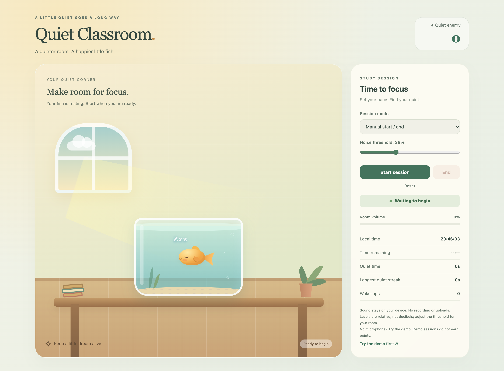

# Quiet Classroom

A browser-based focus companion that turns room noise into a living aquarium. Keep the space quiet to let a little fish sleep, build a quiet streak, and earn points. When sustained noise crosses your chosen threshold, the fish wakes up and the interface responds.

**[Explore the live demo](https://quiet-classroom.vercel.app/)**



## Contents

- [Features](#features)
- [Technology stack](#technology-stack)
- [Getting started](#getting-started)
- [How sound feedback works](#how-sound-feedback-works)
- [Run locally](#run-locally)
- [Configuration](#configuration)
- [Project structure](#project-structure)
- [Privacy and session lifecycle](#privacy-and-session-lifecycle)
- [Development checks](#development-checks)
- [Deployment](#deployment)
- [Troubleshooting](#troubleshooting)
- [Known limitations](#known-limitations)
- [Contributing](#contributing)
- [Support and change history](#support-and-change-history)
- [License](#license)

## Features

- **Animated feedback:** a sleeping and waking fish, moving fins, bubbles, and swaying plants make the room feel alive.
- **Three session modes:** start and end manually, set a duration, or schedule a local start and end time.
- **Adjustable noise threshold:** tune the response to your microphone and surroundings using a live volume meter.
- **Session tracking:** review your score, quiet time, longest quiet streak, and wake-ups.
- **Microphone-free demo:** explore the interaction with simulated sound and no points awarded.
- **Responsive interface:** use the controls beside the aquarium on desktop or below it on smaller screens.
- **Time-based themes:** morning, afternoon, and night styling follows your device's local time.
- **Accessibility support:** labeled controls, visible keyboard focus, a keyboard-accessible results dialog, and reduced-motion styling.

## Technology stack

| Layer | Implementation |
| --- | --- |
| Interface | Semantic HTML and plain JavaScript |
| Visuals | CSS gradients, shapes, keyframe animations, and media queries |
| Audio input | Browser `getUserMedia` and Web Audio APIs |
| Local development | Node.js built-in HTTP and file-system modules |
| Production hosting | Vercel static hosting |

There is no frontend framework, backend service, database, or runtime package dependency. Audio analysis and session state live in the browser.

## Getting started

Open **[quiet-classroom.vercel.app](https://quiet-classroom.vercel.app/)** in a browser and choose a session mode:

| Mode | Behavior |
| --- | --- |
| Manual start / end | Run a session until you select **End**. |
| Timed session | Choose a duration from 1 to 1440 minutes. The timer starts after microphone access is granted. |
| Scheduled session | Choose local start and end times, including an overnight range. Keep the page and browser open. |

Select **Start session**, allow microphone access, and adjust **Noise threshold** while watching **Room volume**. Stay quiet to keep the fish asleep. Select **End** to view the session summary, **Done** to close it, or **Reset** to clear the session.

To explore without microphone access, select **Try the demo first**, then **Simulate a sound** to wake the fish. Demo sessions do not earn points or record quiet time and wake-ups.

## How sound feedback works

The app reads microphone samples through the Web Audio API, calculates their root mean square amplitude, and scales that value into a relative percentage for the meter.

- Sound must stay above the selected threshold for **300 milliseconds** to wake the fish.
- A sustained noisy episode counts as **one wake-up** and subtracts **25 points**, without taking the score below zero.
- The fish returns to sleep after **1.4 seconds** below **90% of the threshold**. This gap helps prevent rapid switching near the boundary.
- Quiet time earns points, with a growing bonus for longer quiet streaks. Sound above the threshold resets the streak.

The meter is **not a calibrated decibel measurement**. Microphone gain, device placement, and room acoustics affect the reading, so adjust the threshold for your setup.

## Run locally

### Prerequisites

- Node.js 18 or later, with npm available.
- Git to clone the repository, or a downloaded copy of the source.
- A browser that supports the Web Audio API and microphone access. A microphone is optional when using the demo.

The app has no runtime package dependencies and needs no build step or package installation.

### Installation and startup

```sh
git clone https://github.com/yz5099-sys/Quiet-Classroom.git
cd Quiet-Classroom
npm start
```

Open **http://localhost:3000**. To choose a different port:

```sh
PORT=8080 npm start
```

The local server binds to `127.0.0.1`. For hosted use, serve the app over HTTPS so the browser can request microphone access.

## Configuration

| Setting | Default | How to change it |
| --- | --- | --- |
| Local server port | `3000` | Set the `PORT` environment variable before starting. |
| Local server address | `127.0.0.1` | Defined in `server.mjs`; the development server listens on the local machine. |
| Noise threshold | `38%` | Adjust the in-app slider from 10% to 90%. |
| Timed session duration | `10 minutes` | Set 1 to 1440 minutes in the control panel. |
| Appearance | Device local time | Morning, afternoon, and night themes are selected automatically. |

The project does not load `.env` files and requires no API keys or service credentials. Settings and session results are not saved between page loads.

On PowerShell, set a custom port with:

```powershell
$env:PORT = "8080"
npm start
```

## Project structure

```text
index.html          Interface and classroom illustration structure
style.css           Layout, themes, responsive styles, and animations
script.js           Audio analysis, scheduling, scoring, and session controls
server.mjs          Local static server using Node.js built-in modules
favicon.svg         Aquarium-inspired browser icon
public/             Matching static entry and assets for public-directory hosting
design/screenshots/ Desktop, mobile, sound-response, and results screenshots
vercel.json         Vercel response headers and microphone permission policy
```

The root and `public/` HTML entries each load their adjacent CSS, JavaScript, and favicon. Keep these copies synchronized when changing the interface. The illustration and animations are implemented with HTML and CSS; no image assets or animation libraries are needed at runtime.

## Privacy and session lifecycle

Microphone sound is analyzed on the device. The app does not record audio, upload audio, or persist session results.

Scheduled sessions request microphone permission when created and disable audio input until their start time. Ending, canceling, resetting, or leaving the page stops microphone tracks and clears session timers and animation frames.

Suspended audio processing and muted input do not earn quiet time. Unobserved time after a background tab resumes is not added in full to the score. Browser throttling and device sleep can delay scheduled actions; this app relies on the page remaining open.

## Development checks

Run the JavaScript syntax checks:

```sh
npm run check
```

Browser regression coverage includes simulated sound, quiet recovery, demo isolation, microphone cleanup, permission denial and cancellation, duration validation, overnight scheduling, automatic endings, responsive layouts, and reduced motion. Microphone sensitivity and browser or operating-system permissions should also be checked on a real device.

Before opening a pull request, also check a real browser session:

1. Start and end a microphone session; confirm the browser releases microphone access afterward.
2. Deny microphone access and verify that the message and demo remain usable.
3. Test sustained sound, quiet recovery, and the final results dialog.
4. Verify manual, timed, and scheduled modes, including cancellation.
5. Check keyboard navigation, reduced motion, and narrow-screen layouts.
6. Confirm that the root and `public/` copies of HTML, CSS, JavaScript, and the favicon remain synchronized.

The project has no configured CI workflow. Run the relevant checks locally before submitting a change.

## Deployment

The production site is hosted on Vercel:

**[https://quiet-classroom.vercel.app/](https://quiet-classroom.vercel.app/)**

### Vercel

Import this GitHub repository into Vercel and use static hosting without a framework build. Publish the directory containing `index.html` and its adjacent assets. The repository provides matching entry files at the root and in `public/`; select the directory that matches your hosting configuration. The Node.js local server is not required in production.

### Other static hosts

The app can also be served by a static host using the root files or the contents of `public/`. Serve HTML, CSS, JavaScript, and SVG with their correct content types. The Vercel configuration sets `Permissions-Policy: microphone=(self)` and lets static assets resolve directly.


## Troubleshooting

| Symptom | What to check |
| --- | --- |
| The microphone cannot be accessed | Use the HTTPS production site or localhost. Check browser site permissions and operating-system microphone permissions. |
| The browser reports no microphone | Connect an input device and verify that it works in the operating system, or use the demo. |
| The fish wakes too easily or never wakes | Adjust the threshold and microphone placement. The meter is relative to the input signal, not a decibel reading. |
| Sound detection is paused | Return to the page and click it to resume suspended audio processing. If the device disconnected, start a new session. |
| A scheduled session starts late | Keep the page open and the device awake. Browser background throttling and sleep can delay timers. |
| Styles or interactions do not load after deployment | Check that CSS and JavaScript URLs resolve to their files, with the correct content types, rather than to an HTML fallback. |
| The local server cannot start | Check your Node.js version and whether the selected port is already in use. Set another `PORT` if necessary. |

## Known limitations

- Noise percentages vary across microphones and gain settings; this is not a sound-level meter.
- Sessions run inside an open browser page. There is no background scheduler, account system, or cross-device synchronization.
- Reloading the page clears settings and results. There is no persistent session history or export feature.
- The interface is in English. Native permission dialogs and time-input controls follow the browser or operating system.
- Root and `public/` assets are maintained as matching copies rather than generated by a build pipeline.

## Contributing

Bug reports and pull requests are welcome through [GitHub Issues](https://github.com/yz5099-sys/Quiet-Classroom/issues) and [Pull Requests](https://github.com/yz5099-sys/Quiet-Classroom/pulls).

For a code contribution:

1. Check existing issues and discuss substantial behavior changes before implementation.
2. Fork the repository and create a branch for a focused change.
3. Keep the implementation dependency-free where practical and preserve keyboard and reduced-motion support.
4. Synchronize the root and `public/` assets, run the syntax checks, and verify the affected browser flows.
5. Open a pull request describing the problem, the resulting behavior, and how you validated it. Include screenshots for visual changes.

For a reproducible bug report, include the browser and operating-system versions, steps to reproduce, expected behavior, actual behavior, and relevant console errors. Describe the microphone setup when sound detection is involved. Do not attach private audio recordings, credentials, or other sensitive information to public issues.

## Support and change history

Use [GitHub Issues](https://github.com/yz5099-sys/Quiet-Classroom/issues) for questions, bugs, and feature requests. Review the [commit history](https://github.com/yz5099-sys/Quiet-Classroom/commits/main/) for changes to the project.

## License

No license file has been added to this repository. An open-source license has not been specified.
