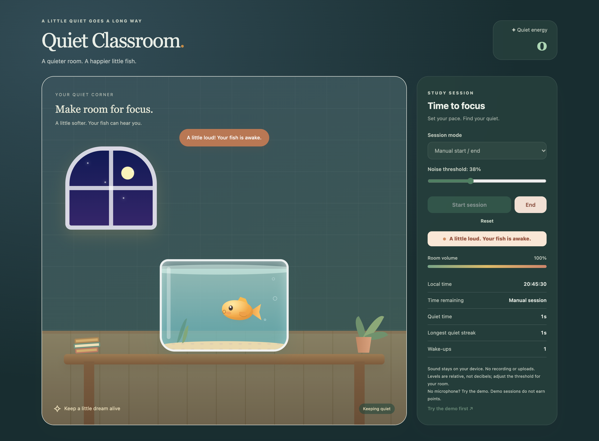
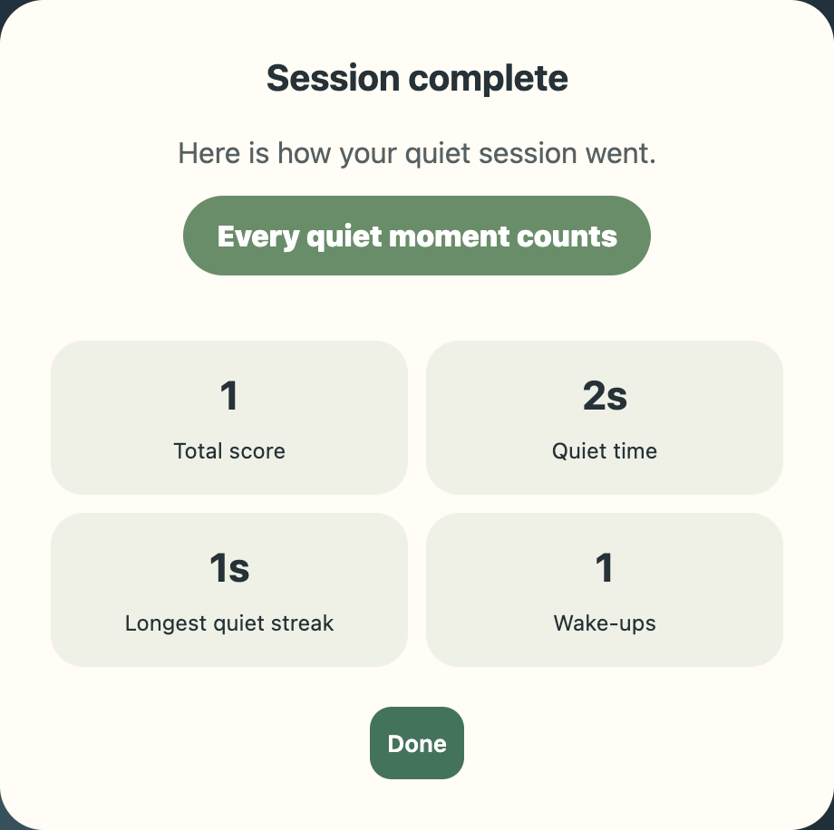
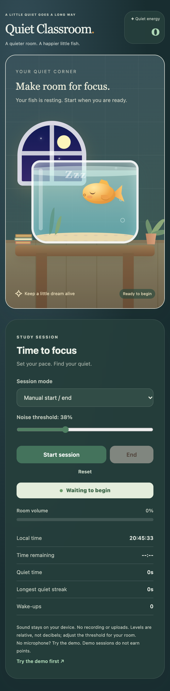
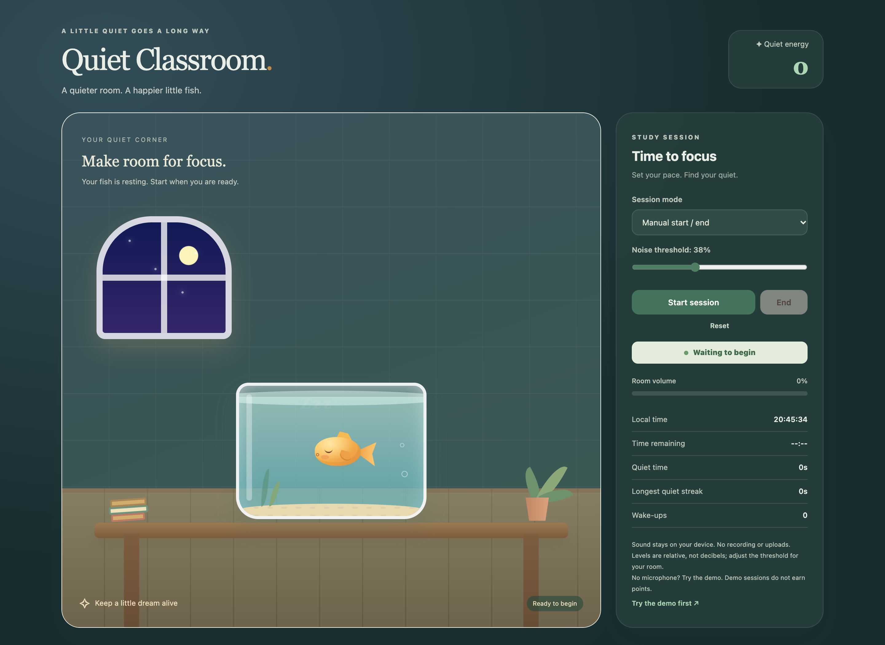

# Quiet Classroom design and gameplay

[Open the live website](https://quiet-classroom.vercel.app/) · [Download the design reflection and illustrated gameplay guide](Quiet_Classroom_Design_With_Screenshots_and_Gameplay.docx)

The Word document includes the design intentions, AI reflection, repository and live website links, three interface screenshots, and a How to play section. This folder contains five screenshots of the implemented English interface. They are screenshots, not early hand-drawn sketches. Sound-response and result views were captured with controlled microphone test input; no classroom audio was recorded.

## How to play

Start with the controls on the right. Choose **Manual start / end**, **Timed session**, or **Scheduled session**. Timed sessions accept 1 to 1440 minutes; scheduled sessions use local start and end times and require the page to stay open.

Select **Start session** and allow microphone access. Adjust **Noise threshold** while watching **Room volume**. The level is relative microphone amplitude, not decibels. Keep the room quiet to let the fish sleep and earn points; longer quiet streaks increase the reward.

Sound above the threshold for 0.3 seconds wakes the fish and subtracts 25 points, never below zero. The alert, eye, and swimming animation show the disturbance. Continuous noise counts as one wake-up. After 1.4 seconds below 90 percent of the threshold, the fish sleeps again.

Select **End** to review total score, quiet time, longest streak, and wake-ups. Select **Done** to close the summary or **Reset** to clear the session. Stopping and resetting release microphone access.

For a microphone-free tour, choose **Try the demo first**, then **Simulate a sound**. The demo illustrates the fish response without awarding points or recording quiet time and wake-ups.

## Interface screenshots

### Desktop overview

### Sound response

### Session results

### Mobile layout

### Night theme

